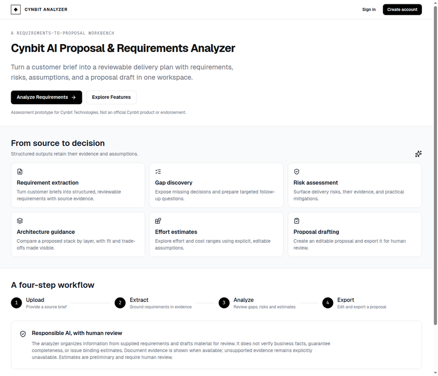
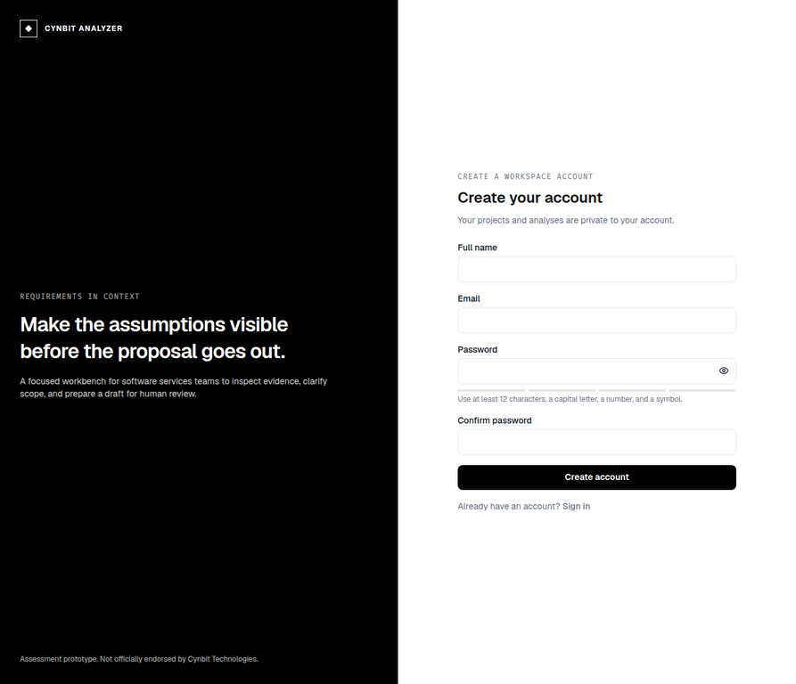

# Cynbit AI Proposal & Requirements Analyzer

> **Assessment prototype only.** This is an AI/ML Engineer Intern assessment prototype for Cynbit Technologies. It is not an official Cynbit product or endorsement. It contains no real customer records, verified service catalog, accuracy claims, client references, or production service guarantee.

The application turns a supplied PDF, DOCX, TXT, or pasted brief into a reviewable requirements workspace: source-grounded requirements, gaps and follow-up questions, risks, a deterministic complexity score, service-line suggestions, optional architecture guidance, an assumptions-based estimate, and a 17-section editable proposal. It is designed for human review, not autonomous scoping or quoting.

## Run locally

Requirements: Node.js compatible with the pinned workspace dependencies, Corepack/pnpm 11, Python 3.12, and a Neon PostgreSQL database. Groq access requires one or more user-owned API keys. OCR runs locally after dependencies are installed, but Neon and Groq analysis still require network access. No test customer/account data is preloaded.

1. Copy `.env.example` to `.env` and fill `DATABASE_URL` with the Neon connection string. For Groq, use numbered slots such as `GROQ_KEY_1`, `GROQ_KEY_2`, and `GROQ_KEY_3` (loaded in numeric order), or set `GROQ_API_KEYS` as a delimited pool; `GROQ_API_KEY` remains supported for one legacy key. Keep real keys only in `.env`, which is ignored by Git, and restart the backend after changing it.
2. For a fresh database, apply `database/migrations/001_initial_schema.sql` in Neon’s SQL Editor. `database/schema.sql` is the matching current-schema snapshot. The migration must be applied manually; the application does not silently create or migrate database tables on startup.
3. Create/install the backend environment and frontend dependencies:

   ```sh
   python3 -m venv .venv
   .venv/bin/pip install -r backend/requirements.txt
   corepack enable
   pnpm install --frozen-lockfile
   ```

4. Start the API and frontend in separate terminals from the repository root:

   ```sh
   pnpm api
   ```

   ```sh
   npm run dev
   ```

   `pnpm dev:full` starts both services together. The API listens on port `8765`; Vite listens on port `3000` and proxies `/api` and `/health` to the API. The example keeps `PUBLIC_HTTPS=false` for plain-HTTP local development. Set it to `true` only for public HTTPS Preview or hosted deployments; keep it false for custom local HTTP origins and update `CORS_ORIGINS` as needed.

The API is FastAPI (`backend/app`) and the SPA is Vite/React (`frontend`). If you run Uvicorn directly from the repository root, use `.venv/bin/uvicorn app.main:app --app-dir backend --env-file .env --reload --port 8765`.

## Environment configuration

- `DATABASE_URL`: Neon PostgreSQL connection string. Required for application accounts and persisted projects/documents/analyses/proposals.
- `GROQ_KEY_1`, `GROQ_KEY_2`, ...: preferred server-only key slots, loaded by increasing numeric suffix; gaps are allowed. `GROQ_API_KEYS` remains available as a comma/semicolon/newline-delimited pool, and `GROQ_API_KEY` remains the backward-compatible single-key fallback. Requests rotate their starting key and try the next configured key after authentication/rate-limit responses. Use only keys you are authorized to use and respect Groq’s account limits and terms. Restart the backend after editing `.env`.
- If the backend reports it tried only one key, run this from the repository root with the project virtual environment active; it prints a count only, never key values: `python -c "from dotenv import load_dotenv; import sys; load_dotenv('.env', override=True); sys.path.insert(0, 'backend'); from app.config import Settings; print('Groq keys loaded:', len(Settings().groq_keys))"`. Every numbered slot must be written as `GROQ_KEY_n=your_key` (including the `=`) and the backend must be restarted after changes. A 429 after multiple keys were tried can still mean the provider/account quota is exhausted; rotating keys does not bypass provider limits.
- The configured default model is `openai/gpt-oss-120b` at `https://api.groq.com/openai/v1`; it can be changed with `GROQ_MODEL`/`GROQ_BASE_URL`.
- `CORS_ORIGINS`: comma-separated exact browser origins. Defaults cover local Vite development only.
- `PUBLIC_HTTPS`: set `true` for HTTPS Preview or hosted deployments so session and CSRF cookies use `Secure; SameSite=None`. Never put API keys in a `VITE_*` variable.
- `VITE_API_BASE`: browser-visible API prefix. Use `/api` for Vite Preview/proxy; for Vercel-to-Render direct API calls use `https://<render-service>.onrender.com/api` and allow the exact Vercel origin in backend CORS.
- `SESSION_TTL_HOURS`: server-side session duration (default 24 hours).

## Deploy configuration templates

The repository includes `vercel.json` for the static SPA and `render.yaml` for a Render-hosted FastAPI service. These are configuration templates, not evidence of a production deployment. In Vercel, set the browser-safe `VITE_API_BASE` to the deployed Render API URL ending in `/api`. In Render, provide `DATABASE_URL`, either `GROQ_API_KEYS` or `GROQ_API_KEY`, `CORS_ORIGINS` (your exact Vercel origin), and `PUBLIC_HTTPS=true`; store actual values as server-side secrets, not in frontend variables. The configured health path is `/health`. Apply `database/migrations/001_initial_schema.sql` to Neon before accepting traffic. Test the auth cookie in target browsers: Vercel and Render are separate sites, and browser third-party-cookie policies may block cross-site session cookies even with `SameSite=None; Secure`. A custom same-site domain or same-origin API proxy may be needed. No hosting account, DNS, or production deployment is configured by this repository.

For managed Webdev publication, the root `Dockerfile` runs the FastAPI backend (binding `PORT`, default `3000`; unauthenticated health check `/health`) while a pinned pnpm command builds `frontend/dist` as the static SPA. Published `/api/*` and `/health` requests route to the container; other paths use the SPA with fallback. The root `.gcloudignore` keeps generated dependency links, build output, and caches out of the source archive; the build reinstalls from the committed lockfile. Set separate **Production** `DATABASE_URL` and numbered `GROQ_KEY_1`, `GROQ_KEY_2`, ... slots (or the supported `GROQ_API_KEYS`/`GROQ_API_KEY` fallback) using secure secret input; do not promote or copy development credentials. Apply the numbered Neon migration to that production database before accepting account or analysis traffic. The Vite client uses same-origin `/api`, so this route arrangement does not require an external CORS origin. Publication still depends on the platform build, production credentials, and the database migration; repository configuration is not proof of a successful deployment.

## Data handling and limitations

- The uploaded original binary is parsed in the request; extracted text/page blocks are stored with its project in PostgreSQL for later analysis. Protect the Neon database accordingly. Project/account deletion removes associated stored records according to the schema’s cascade relationships.
- PDF text extraction uses PyMuPDF; pages with fewer than 40 non-whitespace characters of selectable text are rendered at 200 DPI and processed with local RapidOCR/ONNX Runtime. OCR is limited to 30 pages per PDF and 20 megapixels per rendered page; larger OCR workloads are rejected, not silently truncated. DOCX images and handwriting are not separately OCR-processed. OCR can miss or misread low-quality scans, so review extracted requirements and citations against the original. The original binary is parsed in the request; extracted text/page blocks are stored with its project in PostgreSQL.
- Evidence is retained only when an exact snippet occurs in extracted source text. Unsupported requirement/gap/question/risk evidence is null, and the UI explicitly reports that no supporting evidence was found. Source pages are shown only when available.
- Complexity is deterministic. Estimates use visible rate, contingency, team-size, and phase-hour assumptions; they are preliminary and are not quotes or commitments. Cost is total person-hours × hourly rate × (1 + contingency/100); sequential schedule is person-hours ÷ (team size × eight working hours/day). Team size changes schedule, not total labor hours or cost. User-adjusted values recalculate in the page but are not persisted to the database.
- Service suggestions are not verified Cynbit catalog entries. Verify any suggested line before including it in a real proposal.
- Analysis jobs run asynchronously in the API process. This prototype does not provide a separate durable job queue or automatic retry of jobs after a server restart. Groq availability, rate limits, and generated output are external dependencies.
- Proposal drafts are AI-generated and do not have sentence-level citations; verify document-specific claims against the Requirements and Risks source snippets before sharing. Markdown, DOCX, and PDF export are implemented.
- Analytics display only persisted API aggregates; synthetic briefs in `sample_data/` are evaluation inputs and are not seeded into accounts.

## Screenshots





## Checks and project documents

```sh
pnpm typecheck
pnpm test:all
pnpm build
```

The test suites use deterministic fixtures and mocked LLM responses; they do not measure real-world model accuracy. See [`docs/EVALUATION.md`](docs/EVALUATION.md), [`docs/AI_OPPORTUNITY_REPORT.md`](docs/AI_OPPORTUNITY_REPORT.md), [`docs/TECHNICAL_APPROACH.md`](docs/TECHNICAL_APPROACH.md), [`docs/ARCHITECTURE.md`](docs/ARCHITECTURE.md), and the synthetic expectations in [`sample_data/`](sample_data/).
