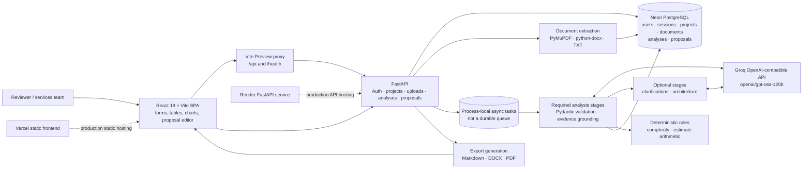

# System Architecture

## Boundaries

The browser stores transient UI state only; session identity is server-side and sent by an HTTP-only cookie. The external Groq provider receives the source text for requested analysis stages. Neon stores extracted document text and analysis outputs. Users should therefore treat Neon as containing customer-sensitive material and configure access/retention accordingly. No original binary object store or OCR service is part of this implementation.

Vercel and Render are documented deployment targets, not active deployments. Their separate-site origin relationship can interact with browser third-party-cookie restrictions. Analysis background work is process-local; persisted status does not make an in-flight task durable across restarts.
